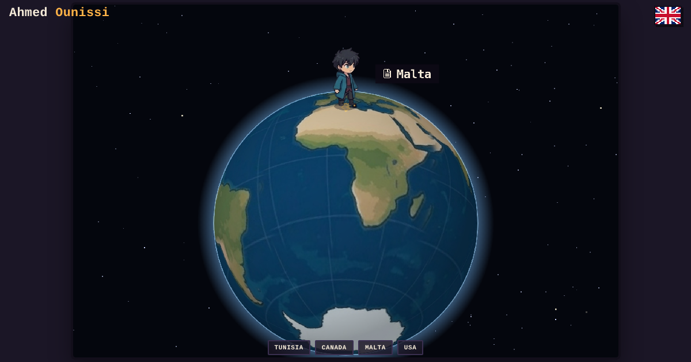
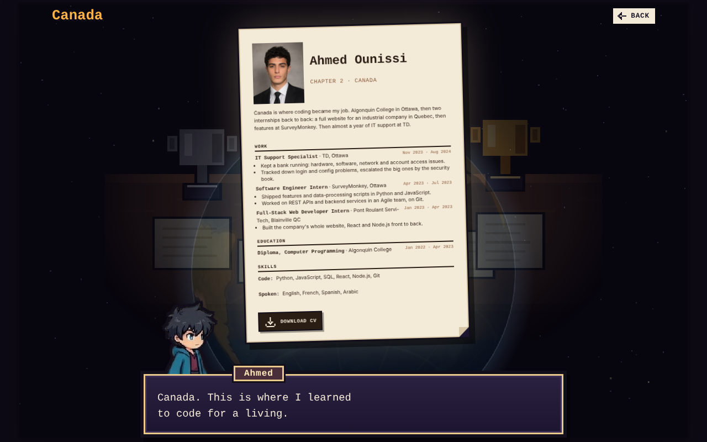
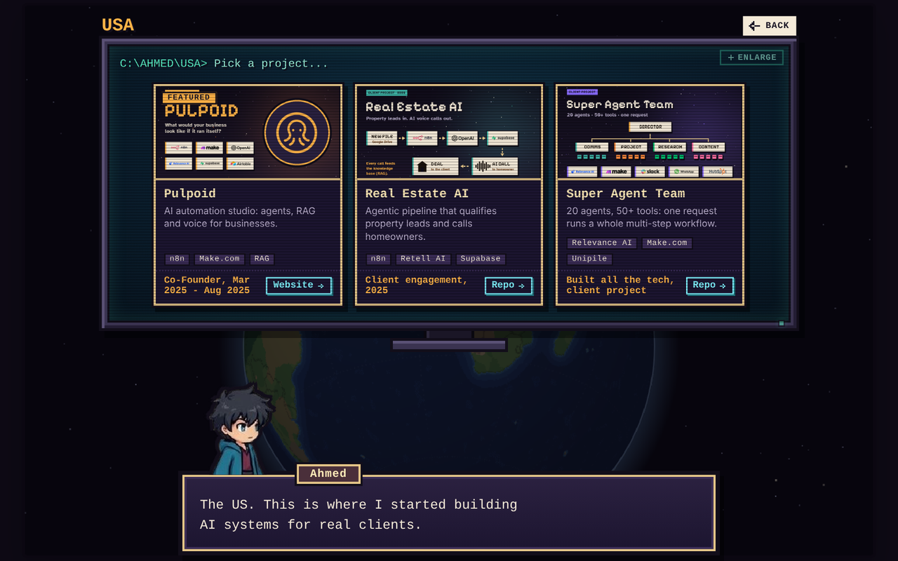

# Ahmed Ounissi | Portfolio

**Live:** https://a-ounissi.github.io/AO-Portfolio/

A pixel-art globe instead of a plain resume page. I've lived and worked in a few countries, so the site follows that
path: drag the globe, walk the character to a country, and that chapter of the story opens.



| Country | Chapter |
| ------- | ------- |
| Tunisia | Where it started, plus how to reach me |
| Canada  | Algonquin College, internships at Pont Roulant Servi-Tech and SurveyMonkey, IT support at TD |
| Malta   | B.S. Software Engineering at the American University of Malta, and my capstone |
| USA     | Pulpoid and the AI systems I built for clients |




## How it works

- Plain HTML, CSS and JavaScript. No framework, no build step.
- The globe is drawn on a canvas: country outlines are projected onto a sphere and turned under the character's feet.
- Each country is one file in `room/zones/` (see [room/zones/README.md](room/zones/README.md)).
- All text, links and images live in one file, `content.json` ([format](docs/content.md)), in English and French.

## Run it locally

```
python -m http.server 8000
```

Then open http://localhost:8000. Opening `index.html` directly won't load `content.json` (the browser blocks it).

## Deploy

GitHub Pages: Settings > Pages > Deploy from branch `main`, folder `/ (root)`.

## Credits

Icons from [Pixelarticons](https://pixelarticons.com) (MIT). Country outlines from [Natural Earth](https://www.naturalearthdata.com) (public domain).

## Contact

[LinkedIn](https://www.linkedin.com/in/ahmed-ounissi-94b851253) · [GitHub](https://github.com/A-Ounissi) · ounissi.a.career@gmail.com
